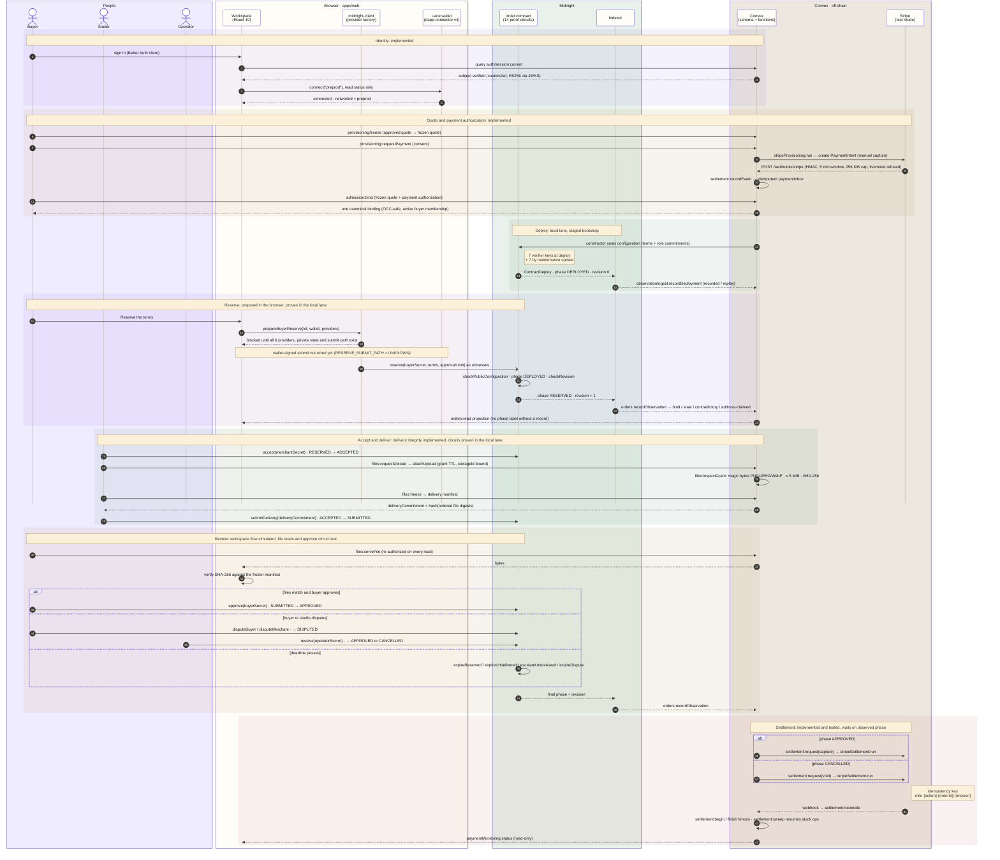

# Milo

**Private agreements. Clear approvals.**

Milo is a privacy-first commissioning workspace for one bounded deal: a buyer and a studio agree a
fixed price for a pack of three images. A Midnight Compact contract enforces the order rules. Stripe
handles payment off chain. The brief, the price, the participants' secrets and the delivered files
stay private; only the phase, the revision and commitments are public.

[Demo video](https://youtu.be/nyB9qJ1OL-4) · [Live workspace](https://milo-xkq.vercel.app) ·
[Slide deck](https://milo-xkq.vercel.app/milo-wave2-deck.pdf)


## What is real and what is simulated

| Layer | State | Where |
| --- | --- | --- |
| Compact contract | Compiles (compactc 0.31.1); proof and semantic-guard tests pass; local 14-circuit sweep | `packages/contract/` |
| Midnight client | Provider factory, typed errors, Preprod network guard, Lace dapp-connector v4; reserve and accept preparation fails closed and stops before signing | `packages/midnight-client/` |
| Convex backend | Canonical admission, chain-observation ingest, order projection, Stripe settlement inbox | `convex/` |
| Identity | Better Auth session verified by Convex (`customJwt`, RS256); legacy `did:privy` subjects still accepted | `apps/web/src/auth-client.ts`, `convex/auth.config.ts` |
| Payments | Stripe test mode only; capture on `APPROVED`, void on `CANCELLED`; signed webhooks | `convex/http.ts`, `convex/settlement.ts` |
| Browser workspace | Full order lifecycle runs in an **in-memory simulator**; Lace, Convex session, order record and payment monitor are real but read-only | `apps/web/` |

Not done yet: a wallet-signed reserve from the browser, chain data driving the workspace, and a
Preprod transaction. Acceptance is published as **0/6 provider** and **0/14 operation** until those
land. Retained Preprod deploy attempts failed on DUST balancing, and the Midnight-hosted Preprod
endpoints were decommissioned on 2026-10-09, so the proof evidence comes from local runs.

## The contract

`packages/contract/src/order.compact` declares 25 circuits: 16 exported, of which 14 carry proofs
and 2 are pure hash helpers.

```text
DEPLOYED → RESERVED → ACCEPTED → SUBMITTED → APPROVED
                 ↘ CANCELLED      ↘ DISPUTED → resolve → APPROVED | CANCELLED
```

- **Proof-bearing transitions:** `reserve`, `accept`, `decline`, `submitDelivery`, `approve`,
  `disputeBuyer`, `disputeMerchant`, `resolve`, `cancelReserved`, `escalateUnreviewed`,
  `expireBootstrap`, `expireReserved`, `expireUndelivered`, `expireDispute`.
- **Private witnesses:** buyer, merchant and operator secrets, the agreed terms and the buyer's
  approval limit.
- **Public ledger:** `phase`, `revision`, `deliveryCommitment`, `evidenceCommitment`, plus a sealed
  `configuration` that holds the terms commitment and the role commitments.
- **Roles by capability:** `hashCapability` (`persistentHash("milo:capability:v1", secret)`) binds a
  secret to a role, so a participant proves authority without revealing identity.
- **Guards:** every exported transition checks the sealed configuration, the phase and the expected
  revision, so out-of-order and stale transitions are rejected.
- **Staged deploy:** a single-transaction deploy of all 14 verifier keys exceeds the per-transaction
  execution budget, so 7 keys deploy with the contract and 7 install through a maintenance update.

Details: [contract README](packages/contract/README.md) ·
[contract spec](packages/contract/SPEC.md) · [Midnight integration](docs/MIDNIGHT-INTEGRATION.md).

## Backend guarantees

- **Stripe webhooks** (`convex/http.ts`): HMAC signature check, 5-minute replay window, 256 KiB body
  cap, `livemode` events refused, idempotent inbox, settlement fenced on begin, reconcile and sweep.
- **Delivery integrity** (`packages/backend/src/delivery-policy.ts`): uploads are checked by magic
  bytes (PNG, JPEG, WebP) and a 5 MiB limit, then frozen; the delivery commitment is the hash of the
  ordered file digests; every read is re-authorized and upload grants expire.
- **Chain observation** (`convex/observationIngest.ts`): durable ingest with `bind`, `replay`,
  `stale`, `contradictory` and `address-claimed` verdicts; the order record comes from observations,
  not fixtures.
- **Release gates** (`packages/backend/src/release-flags.ts`): `immutableOrderAdmission` and
  `r1Complete` stay false until stored receipts exist.

## Architecture

One order, end to end. Every arrow names the real module or Convex function. Each colored band is
one stage of the order. A note in each band says whether the stage is **implemented**, **local
lane** (proven with the Node runner in `packages/integration`, not yet from the browser) or
**prepared** (code exists and fails closed, but is not yet connected).



## Repository map

| Path | Purpose |
| --- | --- |
| `apps/web` | React 19 workspace and public site (React Router 8, Radix UI, plain CSS) |
| `packages/contract` | Compact contract, spec and contract tests |
| `packages/domain` | Pure order simulator and recovery-kit state machine used by the workspace |
| `packages/midnight-client` | Browser Midnight client: providers, wallet, fail-closed circuit preparation |
| `packages/backend` | Server-side policy and Stripe adapters used by Convex |
| `packages/integration` | Node runner for the local native network and Preprod lanes |
| `convex` | Convex schema, mutations, HTTP routes and settlement |
| `scripts` | Setup, dev server, build, contract compile and test runners |
| `e2e` | End-to-end harness and route smoke flows |

The design corpus (`01`–`08`) lives in [`docs/plan/`](docs/plan/); `npm run check:plan` reads it.

## Run it

Needs Linux x86_64, Node 24.x, npm, Python 3, curl, tar/xz and sha256sum. `scripts/setup.sh`
installs the pinned Bun (1.4.2) and the Compact toolchain into `.tools/`. The integration lane
provisions its own pinned Node 26.11.1 runtime under `.tools/node-runtime/`; the app itself runs on
Bun and does not use it.

```sh
sh scripts/setup.sh
npm run contract:compile   # compile before typecheck or tests
npm run dev                # http://localhost:3000 (try /demo and /orders/sample-001)
npm run typecheck
npm run lint
npm run test:unit
npm run build              # static output in dist/, public settings in dist/api/public-config
```

Copy `.env.example` to `.env.local` and set `CONVEX_URL` and `BETTER_AUTH_URL` to enable the live
read-only panels on `/connections`. The workspace runs without them.

## Testing

- `npm run test:unit`: 696 tests across 63 files (contract, domain, backend, web, midnight-client,
  convex, e2e, scripts).
- `npm run test:integration`: provisions the pinned Node runtime and runs the
  `packages/integration` tests.
- `npm run test:native-network`: local Midnight node lane (see the
  [integration README](packages/integration/README.md)).
- Accessibility: axe reports 0 serious or critical issues on every public and workspace route at
  desktop and mobile widths (34 page/viewport combinations, served over HTTP).

```bash verify
test -f package.json
test -f packages/contract/src/order.compact
test -f .env.example
```

```bash verify
bun install --frozen-lockfile
bun run typecheck
```

## Safety

Keep `STRIPE_SECRET_KEY`, `STRIPE_WEBHOOK_SECRET` and the Better Auth secret in the server or Convex
environment, never in browser code. Use test-mode keys only; live-mode webhooks are refused. Sample
receipts in the workspace are not proofs.

## Roadmap

1. Sign and submit `reserve` and `accept` from the browser through the provider factory and Lace.
2. Replace the simulator with Convex chain observations so the workspace shows the real order.
3. Pass end to end with Better Auth test accounts and capture a Stripe test-mode payment.
4. Run a local-node or Preprod pass that reports every acceptance row with a reproducible command.

## License

Apache License 2.0, see [LICENSE](LICENSE). Third-party material keeps its own license, see
[third-party notices](THIRD_PARTY_NOTICES.md).

<!-- markdownlint-configure-file {
  "MD013": { "line_length": 100, "tables": false, "code_blocks": false }
} -->
