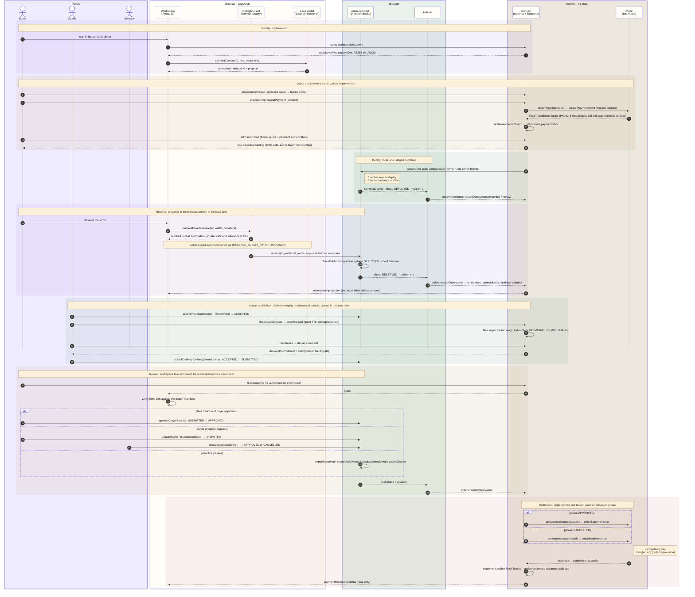

# Milo

**Private agreements. Clear approvals.**

Milo is a privacy-first commissioning workspace for one bounded deal: a buyer and a studio agree a
fixed price for a pack of three images. A Midnight Compact contract enforces the order rules. Stripe
handles payment off chain. The brief, the price, the participants' secrets and the delivered files
stay private; only the phase, the revision and commitments are public.

[Demo video](https://youtu.be/nyB9qJ1OL-4) · [Live workspace](https://milo-nine-delta.vercel.app) ·
[Project status (PDF)](docs/media/milo-status.pdf)


## What is real and what is simulated

| Layer | State | Where |
| --- | --- | --- |
| Compact contract | Compiles (compactc 0.31.1); 2 staged 14-circuit contracts deployed on Preprod; `reserve` and `accept` proved on Preprod; 14/14 local circuit sweep | `packages/contract/` |
| Midnight client | Provider factory, typed errors, Preprod network guard, Lace dapp-connector v4 `WalletProvider` adapter (`getShieldedAddresses` + `balanceUnsealedTransaction`) | `packages/midnight-client/src/provider-factory.ts`, `apps/web/src/chain/providers.ts` |
| Convex backend | Canonical admission, finality-gated chain observer, order projection, Stripe settlement inbox and sweep crons | `convex/` |
| Identity | Better Auth session verified by Convex (`customJwt`, RS256); legacy `did:privy` subjects still accepted | `apps/web/src/auth-client.ts`, `convex/auth.config.ts` |
| Payments | Stripe test mode only; capture on `APPROVED`, void on `CANCELLED`; signed webhooks | `convex/http.ts`, `convex/settlement.ts` |
| Browser workspace | Order lifecycle: quote, card hold, delivery, in-browser SHA-256 check of the three files, approval in Lace | `apps/web/` |

The contract **is deployed on Preprod** at
`09e354f97d420926bb8dd48fa27c2f73ae55bb429201586085ccd8dc8f184fdb` (block 3095269) and
`6d97d92e1c9f1030f8410682c47902efa600f9f42dd79b9e8a89b3fe6b84c6ee`, staged 7+7 (seven keys
deployed, seven installed by one signed maintenance update), with all fourteen operation names
read back from chain state on `ledger-v8`. On Preprod, `reserve` (block 3095493) and `accept`
(block 3095499) have executed with real proofs, and all 14/14 circuits are proved on the local
Midnight network. Browser-signed end-to-end Preprod reserve and hosted Better Auth deployment
remain open; see `docs/RECEIPTS.md`.

## The contract

`packages/contract/src/order.compact` declares 25 circuits: 16 exported, of which 14 carry proofs
and 2 are pure hash helpers.

```text
DEPLOYED → RESERVED → ACCEPTED → SUBMITTED → APPROVED
                 ↘ CANCELLED      ↘ DISPUTED → resolve → APPROVED | CANCELLED
```

- **Proof-bearing transitions:** `reserve`, `accept`, `decline`, `submitDelivery`, `approve`,
  `disputeBuyer`, `disputeMerchant`, `resolve`, `cancelReserved`, `escalateUnreviewed`,
  `expireBootstrap`, `expireReserved`, `expireUndelivered`, `expireDispute`.
- **Private witnesses:** buyer, merchant and operator secrets, the agreed terms and the buyer's
  approval limit.
- **Public ledger:** `phase`, `revision`, `deliveryCommitment`, `evidenceCommitment`, plus a sealed
  `configuration` that holds the terms commitment and the role commitments.
- **Roles by capability:** `hashCapability` (`persistentHash("milo:capability:v1", secret)`) binds a
  secret to a role, so a participant proves authority without revealing identity.
- **Guards:** every exported transition checks the sealed configuration, the phase and the expected
  revision, so out-of-order and stale transitions are rejected.
- **Staged deploy:** a single-transaction deploy of all 14 verifier keys exceeds the per-transaction
  execution budget, so 7 keys deploy with the contract and 7 install through a maintenance update.

### Deployed on Preprod

Two contracts are live on Midnight Preprod, each carrying all 14 proof circuits. Every hash
below was read back from the Blockfrost indexer, so each one is queryable — none is copied
from a local log.

**Deployment is not one transaction per circuit.** The staged 7+7 deploy installs verifier
*keys*: one transaction deploys seven, a second maintenance transaction installs the remaining
seven. Fourteen circuits therefore arrive in two transactions per contract. A circuit *call* is
a separate transaction and does get its own hash, listed separately below.

| Contract | Address | Deploy tx hash (7 keys) | Insert tx hash (7 keys) |
|---|---|---|---|
| Main | `09e354f97d420926bb8dd48fa27c2f73ae55bb429201586085ccd8dc8f184fdb` | `c854587f35e53191797af8d2d79ff8440d82bc7d1770494c87d9951b9ae36e50` | `1c094210cb96316ad28887f9b8f45dfbcec3bb2648973bd717beb708e3de5ca9` |
| Stress instance 0 | `6d97d92e1c9f1030f8410682c47902efa600f9f42dd79b9e8a89b3fe6b84c6ee` | `e12bf102ed4874e241f4fde8d1d90f3de964f7c57283869335603f33c3572a56` | `6ad37524c6d57b43d645679210ddf85d4f173b1f2effcb64361248a85454b40e` |

Both read back as 14 operations with maintenance counter 1, which is the on-chain evidence that
exactly one insert ran per contract.

Circuit calls executed on Preprod, each its own transaction:

| Circuit | Contract | Tx hash | Block |
|---|---|---|---|
| `reserve` | stress instance 0 | `274434a3198edff00f874586c4b06d6234cd9ae1db6707d892e173a876bc8406` | 3095493 |
| `accept` | stress instance 0 | `d27943872ad6e73ef84831afab4d97473e1b332c373bffd4c17378e34f12b27f` | 3095499 |

Read any of them yourself:

```sh
curl -s -X POST -H 'Content-Type: application/json' \
  -d '{"query":"{ block(offset:{height:3095499}) { transactions { hash contractActions { __typename } } } }"}' \
  "https://midnight-preprod.blockfrost.io/api/v0?project_id=$MILO_PREPROD_BLOCKFROST_PROJECT_ID"
```

**What the lane's `txId` field is not.** `submitTxAsync` returns a ledger transaction
identifier, and that value is **not** a queryable indexer transaction hash: passing it to
`transactions(offset: {hash: …})` returns `invalid transaction hash`. Do not cite a `txId` as
on-chain proof. Confirmation comes from observed ledger state — the `ContractUpdate` hash above,
or the `registeredForDustGeneration` flag on a NIGHT UTXO — never from the submit receipt.

### Stress testing at volume

`--stress` drives many complete lifecycles, each on a fresh staged deploy, bounded on
operations, wall clock and DUST:

```sh
MILO_STRESS_OPERATIONS=200 MILO_STRESS_INSTANCES=50 MILO_STRESS_DEADLINE_MS=5400000 \
  node --env-file=.env.preprod packages/integration/src/preprod-lane.mjs --stress
```

Three protocol constraints decide the shape, and none are workarounds:

1. **One contract is one order.** `configuration` is a sealed ledger field, so a deployed
   contract has one fixed set of parties and deadlines, and every terminal phase is final.
   Volume means many instances, not many lifecycles on one instance.
2. **Calls are sequential per instance, but instances can overlap.** A built transaction locks
   the DUST UTXOs that pay its fee until the wallet applies the confirmation, so in-flight
   transactions are capped by **unlocked DUST UTXOs, not by balance**. `MILO_STRESS_CONCURRENCY`
   sets the target and the harness clamps it to the real UTXO count.
3. **No cross-contract calls on Preprod.** Those need ledger version 9; Preprod runs ledger 8.
   "Cross-circuit" here means different circuits of the same contract in one flow.

### Batching saves wall clock, not DUST

Every circuit call is its own transaction and pays its own fee, so a batch of N costs exactly
what N sequential calls cost. `additionalFeeOverhead` is charged **per fee-paying transaction**
and is not refunded, so it scales with the transaction count — batching cannot reduce it.

The only real DUST saving is setting `additionalFeeOverhead` to `0n`, which this lane already
does. That is why fee estimates read `1` speck instead of 0.3 DUST. `dustCostModel` in
`stress-run.mjs` computes the arithmetic so the claim stays checkable.

What concurrency does buy is overlap: N proofs run at once and N transactions can land in the
same or adjacent blocks instead of one per block. The ceiling is the DUST UTXO count — 5 on the
funded wallet — so the best case is roughly 5× wall-clock, never 5× cheaper.

### Running a stress test without running out of memory

The first real run was killed by the OOM killer after two operations. Three fixes, in order of
effect:

1. **Size the proof server to the RAM you have.** A third-party sizing table claims 2 workers = 4 GB,
   4 = 8 GB, 8 = 16 GB, but that figure is **unverified**: no primary Midnight source states it, and
   the idle server on this host sits at 2.3 MB RSS. The closest official figure found is ~50 MB per
   proof, which puts 8 workers near 500 MB. Treat the 4 GB plan as headroom for the wallet, the Node
   heap and proof peaks together, not as a documented prover requirement. The repo's own
   `scripts/native-services-health.ts` passes `--num-workers 1`; starting the server without that
   flag defaults to a larger pool.
2. **Cap Node's heap** so a runaway run fails with a clear `OutOfMemory` instead of being killed
   silently: `NODE_OPTIONS=--max-old-space-size=2048`.
3. **Let the harness refuse rather than die.** `stressStopReason` returns
   `memory-floor-reached` below 1.5 GB free, read from `/proc/meminfo`, so the run stops itself
   and records why instead of vanishing with no receipt.

The proof server binary in this repo is a Nix-built ELF whose interpreter path
(`/nix/store/.../ld-linux-x86-64.so.2`) does not exist here, so it needs the system loader:
`/lib64/ld-linux-x86-64.so.2 .tools/native-midnight/prover/midnight-proof-server --num-workers 1`.

Preprod's own ceilings bound any run: `block_usage` 200,000 bytes and `bytes_written` 50,000
bytes per 6-second block, and a per-account throttle of 10 MB per rolling day. At one
transaction per block, 200 operations is a 20-minute floor before proving time.

Measured on this machine: a stress run reached `reserve` (block 3095493) and `accept` (block
3095499) with real proofs before the process was killed by the host running out of memory
(9 GB total, 9 GB used, two editor processes holding 52%). That is an environment ceiling, not
a harness defect — the same two calls succeed on the main deployment. Run a full 200-operation
sweep only on a host with headroom, and expect each staged deploy plus its proofs to be the
memory high-water mark.

Details: [contract README](packages/contract/README.md) ·
[contract spec](packages/contract/SPEC.md) · [Midnight integration](docs/MIDNIGHT-INTEGRATION.md).

## Backend guarantees

- **Stripe webhooks** (`convex/http.ts`): HMAC signature check, 5-minute replay window, 256 KiB body
  cap, `livemode` events refused, idempotent inbox, settlement fenced on begin, reconcile and sweep.
- **Delivery integrity** (`packages/backend/src/delivery-policy.ts`): uploads are checked by magic
  bytes (PNG, JPEG, WebP) and a 5 MiB limit, then frozen; the delivery commitment is the hash of the
  ordered file digests; every read is re-authorized and upload grants expire.
- **Chain observation** (`convex/observationIngest.ts`): durable ingest with `bind`, `replay`,
  `stale`, `contradictory` and `address-claimed` verdicts; the order record comes from observations,
  not fixtures.
- **Release gates** (`packages/backend/src/release-flags.ts`): `immutableOrderAdmission` and
  `r1Complete` stay false until stored receipts exist.

## Architecture

One order, end to end. Every arrow names the real module or Convex function. Each colored band is
one stage of the order. A note in each band says whether the stage is **implemented**, **local
lane** (proven with the Node runner in `packages/integration`, not yet from the browser) or
**prepared** (code exists and fails closed, but is not yet connected).



## Repository map

| Path | Purpose |
| --- | --- |
| `apps/web` | React 19 workspace and public site (React Router 8, Radix UI, plain CSS) |
| `packages/contract` | Compact contract, spec and contract tests |
| `packages/domain` | Pure order simulator and recovery-kit state machine used by the workspace |
| `packages/midnight-client` | Browser Midnight client: providers, wallet, fail-closed circuit preparation |
| `packages/backend` | Server-side policy and Stripe adapters used by Convex |
| `packages/integration` | Node runner for the local native network and Preprod lanes |
| `convex` | Convex schema, mutations, HTTP routes and settlement |
| `scripts` | Setup, dev server, build, contract compile and test runners |
| `e2e` | End-to-end harness and route smoke flows |

The design corpus (`01`–`08`) lives in [`docs/plan/`](docs/plan/); `npm run check:plan` reads it.

## Run it

Needs Linux x86_64, Node 24.x, npm, Python 3, curl, tar/xz and sha256sum. `scripts/setup.sh`
installs the pinned Bun (1.4.2) and the Compact toolchain into `.tools/`. The integration lane
provisions its own pinned Node 26.11.1 runtime under `.tools/node-runtime/`; the app itself runs on
Bun and does not use it.

```sh
sh scripts/setup.sh
npm run contract:compile   # compile before typecheck or tests
npm run dev                # http://localhost:3000
```

Copy `.env.example` to `.env.local`. A Preprod run reads these variables (names only): `CONVEX_URL`,
`BETTER_AUTH_URL`, `BETTER_AUTH_SECRET`, `STRIPE_SECRET_KEY`, `STRIPE_WEBHOOK_SECRET`,
`MILO_PREPROD_GENESIS_HASH`, `MILO_OPERATOR_EMAILS`. The landing and the legal pages need none of them.

Magic-link mail is sent by one of three providers, chosen with `MAIL_PROVIDER`
(`resend` — the default — `agentmail`, or `brevo`), each reading its own key:
`RESEND_API_KEY`, `AGENTMAIL_API_KEY`, `BREVO_API_KEY`. `MAIL_FROM` is the sender,
and for AgentMail it is also the sending inbox. `MAIL_BASE_URL` (any provider) or
`RESEND_BASE_URL` (Resend only) redirects the send at a local capture server such
as Mailpit, which is how the e2e suite reads the link without a real send.

## Testing

The gates, in CI order (`.github/workflows/local-checks.yml`):
`contract:cohort`, `contract:compile`, `lint`, `typecheck`, `check:plan`,
`test:unit`, `test:integration`, `build`.

`bun run ci` runs that same order locally with the deployment environment
cleared, which is the point: Bun auto-loads `.env.local`, so a plain local build
reads configuration CI does not have and the two can diverge silently.

- `bun run test:unit`: 1,433 tests, run with `--parallel`.
- `bun run test:integration`: provisions the pinned Node runtime and runs the
  `packages/integration` tests.
- `bun run test:native-network`: local Midnight node lane (see the
  [integration README](packages/integration/README.md)).

## Deploy order

**Backend first, then the frontend built against it:** `npx convex deploy --cmd
'bun run build'`, then host `dist/`. A frontend deployed first can call a
function the backend does not have yet, and a failed `useQuery` renders as an
endless `Loading orders` rather than an error. Never remove a Convex function in
the same deploy that stops calling it.

The strict unused-symbol pass must also report zero errors:

```sh
sh scripts/with-bun.sh node_modules/typescript/bin/tsc --noEmit --noUnusedLocals --noUnusedParameters
```

Signed-in pages need a session, so the taste inspector cannot reach them from a cold browser. Start
`PORT=3100 scripts/dev.ts` and stub `/api/public-config` plus the Convex and Better Auth responses in
the browser's network layer; that harness stays outside the repository. Keep every probe under 60 s.
```bash verify
test -f package.json
test -f packages/contract/src/order.compact
test -f .env.example
```

```bash verify
bun install --frozen-lockfile
bun run typecheck
```

## Safety

Keep `STRIPE_SECRET_KEY`, `STRIPE_WEBHOOK_SECRET` and the Better Auth secret in the server or Convex
environment, never in browser code. Use test-mode keys only; live-mode webhooks are refused. Sample
receipts in the workspace are not proofs.

## Roadmap

1. Sign and submit `reserve` and `accept` from the browser through the provider factory and Lace.
2. Replace the simulator with Convex chain observations so the workspace shows the real order.
3. Pass end to end with Better Auth test accounts and capture a Stripe test-mode payment.
4. Run a local-node or Preprod pass that reports every acceptance row with a reproducible command.

## License

Apache License 2.0, see [LICENSE](LICENSE). Third-party material keeps its own license, see
[third-party notices](THIRD_PARTY_NOTICES.md).

<!-- markdownlint-configure-file {
  "MD013": { "line_length": 100, "tables": false, "code_blocks": false }
} -->
