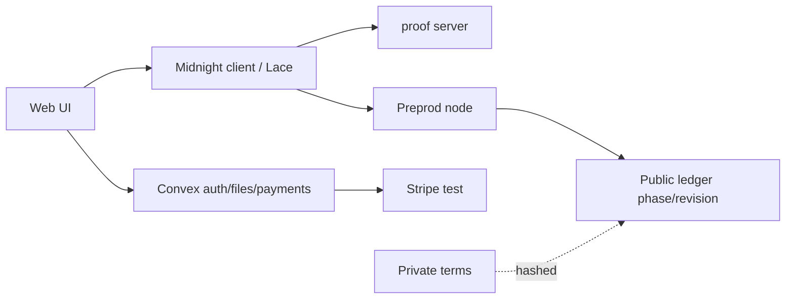

# Midnight integration (dual ledger)

## Dual-ledger model

| Plane | What lives there | Code |
|---|---|---|
| Public ledger | phase, revision, commitments, entrypoints, maintenance authority | `order.compact` circuits; `packages/contract/generated` |
| Private / off-chain | terms (price, rights, scope), file bytes, Stripe payment objects | `packages/domain`, `convex/files.ts`, Stripe test |

Private terms are hashed into `termsCommitment` and never posted as plaintext.
Witnesses and capability secrets stay in wallet private state
(`packages/midnight-client`, integration harness).

## Private-state management

- Buyer/merchant/operator capability secrets: `local-happy.mjs` / provider factory
- Private state IDs per actor: `happy-buyer`, `happy-merchant`
- Recovery kit retains operation identities (`packages/domain/src/recovery-kit.ts`)

## Diagram

### Why no circuit has been executed on Preprod yet (measured 2026-10-31, revised 2026-11-01)

The contract is deployed and all 14 verifier keys match the compiled artifacts byte for
byte, but **no circuit call has ever been submitted** — the deployment is still at
revision 0. The blocker is upstream in the DUST wallet sync, not in the contract, the
proof server or the circuits.

What is proven on chain (re-queried 2026-11-01 against Blockfrost v4 GraphQL):

| Fact | Value |
| --- | --- |
| Circuits deployed | 14 of 14 |
| Verifier keys equal to the compiled artifacts | 14 of 14, sha256-identical at block 3176417 |
| Deploy transaction | `96df7228…`, block 3176413, fee 1, SUCCESS |
| Maintenance insert transaction | `3c83ce2d…`, block 3176417, fee 1, SUCCESS |
| Specks spent | 2 (deploy fee + insert fee) |
| Latest contract action | the insert's `ContractUpdate`, block 3176417 |

That last row is the proof of revision 0, and it needs no deserialization: a circuit call
produces a `ContractCall` action, a deploy produces `ContractDeploy`, and a maintenance
insert produces `ContractUpdate`. The address's entire action history is
`ContractDeploy` then `ContractUpdate`. No `ContractCall` exists, so no circuit has run.

#### The four attempts, and what each died of

| # | Route | Died of |
| --- | --- | --- |
| 1 | standalone `FluentWalletBuilder` + `syncWallet` | `Wallet sync timeout after 90000ms`, after replaying genesis from a run directory that had been reset to a fresh one |
| 2 | `preprod-lane.mjs --call expireBootstrap` on the repo snapshot | restore rejected (`restore-verification-failed`), fell back to full sync, killed at 985,000 of 1,820,957 dust events |
| 3 | the lane again, with `graphql-ws` installed and the six SDK packages pinned | restore passed 18/18 and the tail synced in ~90 s, then died on a missing `midnight-js-utils`; a later run reached 1,455,597 of 1,821,853 (79.9%) in ~51 min |
| 4 | `mn contract call --address … --circuit expireBootstrap` | `SYNC_TIMEOUT` (exit 4) on every attempt |

Attempt 4 is the informative one. The native DUST sidecar works (`dust: native sidecar:
…/@nel349/dust-sync-linux-x64/dust-sync`), a warm `mn dust status` takes **32 s** against
~78 min cold, and the wallet really holds **175,000 DUST across 7 registered UTXOs**. The
call path then refuses to proceed because it needs a full-facade strict sync with a
**hardcoded 120 s timeout on public networks** and no override:
`l = n.syncTimeoutMs ?? (d ? Lg : Fg)` with `Lg = 120000`, `Fg = 30000`.

Neither the wallet nor the DUST balance is the problem. The submission path's sync budget
is, and behind it the sync itself.

#### The root cause is upstream: `midnight-wallet` #425

Issue #425 ("Could not deserialize Ledger Event on `DustSpendProcessed`", opened
2026-05-24, still open) documents it, and the maintainer corrected the diagnosis:

> "This actually wasn't a serialization error as such but that **WASM was running out of
> memory**."

A sync that exhausts WASM memory corrupts `DustLocalState`, and the corruption is silent:

- `serializeState()` does not validate — `Serialization.js` encodes `state.serialize()`
  directly, so whatever is in WASM is written to disk.
- `isStrictlyComplete()` never touches the state. `SyncProgress.js` compares cursors
  (`isCompleteWithin(data, maxGap)` → `|highestRelevantWalletIndex - appliedIndex| <= maxGap`),
  so a corrupted state reports itself fully synced.
- `waitForSyncedState()` just awaits the three sub-wallets; nothing walks the trees.

The failure therefore surfaces later, at the first `walletBalance()`, as #425's
`RuntimeError: unreachable`.

#### Why local hardening cannot close it

`batchUpdates.size` is already **5000** (commit `3ebcca9`, 2026-09-20) — the maintainer's
documented workaround, and a 500x increase over the SDK default of 10. It was present in
every failed attempt above, and a third party reported on #425 that it is not sufficient on
this chain (7.9 h, then the same WASM trap at ~53% of the event range).

The fix is a **projections-based fast sync** that reads the current tree from the indexer
instead of replaying events. It exists only on **ledger 9**: the `./v2` export of
`wallet-sdk-dust-wallet` 5.0.0-rc.1 imports `DustLocalState` from
`@midnightntwrk/ledger-v9`, which is published only as `1.0.0-rc.6`. PR #585, which
prototyped it against `ledger-v8@8.2.0-rc.1`, was **closed unmerged** and
`wallet-sdk-dust-fast-sync` was never published; `ledger-v8` has no 8.2.x release at all.
The maintainers' own position (2026-08-19, issue #639) is that "there is a real fix that is
available on Ledger 9 and Ledger 9 has an imminent release".

A ledger bump is not a version change here. `validateCohort()` in
`packages/integration/src/artifacts.mjs` `deepEqual`s the **entire** dependency map and then
re-resolves each of 15 packages from disk; `preprod-profile.mjs` pins the proof server to
`8.1.3`, the same line as the ledger, and `infra/midnight/compose.yml` pins that image by
digest; and a new `compact-runtime` recompiles `order.compact`, producing different verifier
keys, so the contract must be redeployed. That is a deliberate, separately-scoped decision,
not a step in a hardening round.

#### What the guards do, and do not do

`receipt-freshness` refuses to restore a snapshot that cannot be shown to describe the files
on disk. It is not over-strict: a receipt only claims to describe files it was written at or
after, so files newer than the receipt are reported `UNEXERCISED` rather than `FAIL`, and a
`FAIL` is reserved for a receipt that post-dates the files and still disagrees with them.

G14 (`dust-state-usable`) is the only gate that walks the restored WASM trees, calling
`utxos()` and `walletBalance()` under a 30 s bound. It **detects** a corrupted snapshot at
restore time instead of at the first fee payment, at a cost of about 2 microseconds on a
7-UTXO state. It cannot **prevent** the corruption, which happens inside the ledger WASM
during sync. A run that trips G14 still has no usable snapshot and still falls back to a
full genesis replay.

#### What a future successful run must produce

1. `sync-progress` reaching `dustComplete: true` with no `Wallet.Sync` line in the log.
2. `wallet-state-verified` with `checks: 19` (was 18; G14 is the new one) and `failed: []`.
3. A receipt entry `"id": "dust-state-usable", "status": "PASS"` naming a real utxo count
   and balance.
4. A second run restoring from that snapshot and reaching the same PASS, proving the
   snapshot survived a round trip.
5. A negative control: corrupt one byte of `dust.json`, confirm G14 FAILs, and confirm the
   lane falls back to a full sync instead of proceeding.

Only then attempt `preprod-lane.mjs --call <circuit>`, from the directory the deploy ran in.
Success is a `ContractCall` action on `b653b13a…` and a revision of at least 1.

One caveat on the last step: even a clean sync may not be enough. Issues #700 and #849 (both
open) describe a zero-fee DUST balancing defect that fails on GA Preprod with this exact
stack, so the first circuit call may also need `additionalFeeOverhead` set.

### Private state is per working directory

The private state store is a LevelDB directory named `midnight-level-db`, created
**relative to the process working directory**, and the deploy writes each actor's
witnesses into it as `<label>-<actor>`. A `--call` run started from anywhere else finds
no store, creates an empty one, completes the whole dust sync, and only then reports
`no private state at main-buyer`. The fix is to run the call from the directory the
deploy ran in, or copy that directory's `midnight-level-db` into the new working
directory first. `--call` now refuses immediately when the store holds no `.ldb` file,
so a misconfigured run costs a second rather than two hours.

## Live wiring on Preprod

The order contract is deployed at `b653b13a8ca93308d103d0fc7d0f6eac35dbdfc53d7b70cf3b1fe1d7fdc5818f` (14 of 14 circuits, staged deploy completed 2026-10-28).
The previous deployment `09e354f97d420926bb8dd48fa27c2f73ae55bb429201586085ccd8dc8f184fdb` is superseded: it predates the C-04 fix, so an
unreviewed delivery on it could be escalated but never resolved. The Midnight-hosted Preprod endpoints were retired on 2026-10-09; Blockfrost now serves the indexer (`https://midnight-preprod.blockfrost.io/api/v0`, GraphQL v4) and node RPC, and every request carries a `project_id` token.

| Path | Who calls it | Endpoints | Needs |
| --- | --- | --- | --- |
| Browser to Lace | `apps/web` through the DApp connector v4 | the URIs Lace returns from `getConfiguration` | Lace on Preprod, tDUST |
| Proving | Lace `getProvingProvider`, or a local proof server | zk keys and zkir served from `/zk/<sourceSha256[0:16]>/`, `http://127.0.0.1:6300` | `midnightntwrk/proof-server:8.1.3` for local proving |
| Chain observer | Convex `chainObserver.poll` cron | `MIDNIGHT_PREPROD_INDEXER_HTTP` | `MILO_PREPROD_BLOCKFROST_PROJECT_ID` in the Convex env |
| Login | Better Auth on Convex | `BETTER_AUTH_URL` (the Convex site URL) | `BETTER_AUTH_SECRET`, `SITE_URL`, `RESEND_API_KEY`, `MAIL_FROM` |
| Payments | Convex Stripe actions and `/webhooks/stripe` | Stripe API | `STRIPE_SECRET_KEY`, `STRIPE_WEBHOOK_SECRET`; mode follows the key |
| Operator runs | `packages/integration` in Node | Blockfrost Preprod | `MILO_PREPROD_*`, `MIDNIGHT_PREPROD_SEED` |

`.env.example` lists every variable in three blocks: static build, Convex deployment, Node operator runs.

The build emits every artifact twice: `/zk/…` (unversioned, `must-revalidate`) and
`/zk/<sourceSha256[0:16]>/…` (content-addressed, `immutable`). The client asks for the versioned
copy, because only that one is cached across visits — the unversioned path costs a conditional
request per key on every page load. The version is a build constant (`__ZK_VERSION__`, injected by
`scripts/build.ts`), so a recompile changes the URL and the old directory stays addressable for an
order deployed against it.

## Pinned versions

The Preprod support matrix (read 2026-10-23) pairs a specific set of binaries with this
stack. The preflight in `packages/integration/src/preprod-profile.mjs` asserts them, so a
mismatch fails the preflight rather than the deploy.

| component | pin | asserted where | note |
| --- | --- | --- | --- |
| node | `1.0.400` | `preprod-profile.mjs` `nodeVersion` match | includes ledger 8.1.3 |
| indexer | `4.3.302` | `preprod-profile.mjs` `indexerPrefix` `4.3.` | the exact release has no public tag, image or artifact, so only the line is compared; `4.3.3-hotfix` is marked superseded upstream |
| proof server | `8.1.3` | `preprod-profile.mjs` `proofServer` + `infra/midnight/compose.yml` image digest | security patch for GHSA-wr7g-rr4v-jmj8 |
| compact toolchain | `0.31.1` | `packages/integration/src/artifacts.mjs` `TOOLCHAIN` | ledger 8; 0.34/0.35 target ledger 9 and cannot deploy here |
| midnight-js | `4.1.1` | `package.json` | its own `ledger-v8` 8.1.0 is overridden to 8.1.3 so there is one copy |

The proof-server image is pinned by digest, not tag: `8.1.3` →
`sha256:0f4ab0716985eaebbe55a970348f52ff05ffd8a96631ed7232bd0c4ba02c115c`, from the signed
`build-manifest.json` on the `proof-server-8.1.3` release (2026-10-02).
