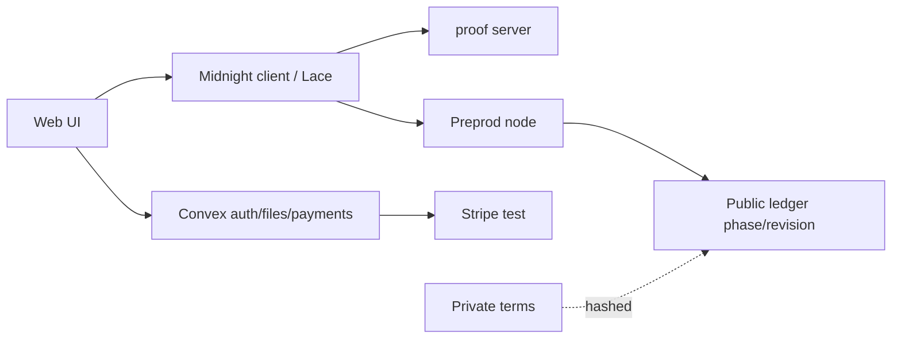

# Midnight integration (dual ledger)

## Dual-ledger model

| Plane | What lives there | Code |
|---|---|---|
| Public ledger | phase, revision, commitments, entrypoints, maintenance authority | `order.compact` circuits; `packages/contract/generated` |
| Private / off-chain | terms (price, rights, scope), file bytes, Stripe payment objects | `packages/domain`, `convex/files.ts`, Stripe test |

Private terms are hashed into `termsCommitment` and never posted as plaintext.
Witnesses and capability secrets stay in wallet private state
(`packages/midnight-client`, integration harness).

## Private-state management

- Buyer/merchant/operator capability secrets: `local-happy.mjs` / provider factory
- Private state IDs per actor: `happy-buyer`, `happy-merchant`
- Recovery kit retains operation identities (`packages/domain/src/recovery-kit.ts`)

## Diagram

### Why no circuit has been executed on Preprod yet (measured 2026-10-31)

The contract is deployed and its 14 verifier keys match the compiled artifacts, but
**no circuit call has ever been submitted** — the deployment is still at revision 0.
The blocker is the DUST wallet sync, not the contract, the proof server or the circuits.

Measured over two attempts against `preprod-r38b`, the snapshot the deploying run left:

| Observation | Value |
| --- | --- |
| DUST progress, first 11 minutes | 179,750 of 1,820,957 events (10%) |
| Extrapolated full dust sync from genesis | roughly 110 minutes |
| `"restored": true` across 95 sync events | **never** — the saved state is not adopted |
| State written by a 57-minute run | `dust.json`, 1,074,309 bytes, then never reloaded |

Two independent guards refuse the fast path, and both are deliberate:

- `dust-seed-fallback` -> `seed-refused`: *"emitted snapshot holds no dust UTXOs for a
  wallet that has already registered NIGHT: a collapsed update carries the tree roots
  but not the wallet's own leaves, so the restored wallet would report zero balance and
  could never spend."*
- `wallet-state-rejected` -> `restore-verification-failed`, `failed: ["receipt-freshness"]`.

Each attempt therefore replays dust from genesis, so one that dies at minute 11 or
minute 57 has made no durable progress. A call needs roughly two hours of uninterrupted
sync first; `MILO_AWAIT_TIMEOUT_MS` must exceed that, and the WSL guest here is capped
at 10 GB of RAM.

`packages/integration/src/preprod-lane.mjs --call <circuit>` exists for exactly this:
one circuit call against the receipt's address, reusing the deploy's private state,
without `--sweep`'s ten fresh deployments. It is **not yet exercised end to end** — the
attempts above died in sync, before reaching it.

## Live wiring on Preprod

The order contract is deployed at `b653b13a8ca93308d103d0fc7d0f6eac35dbdfc53d7b70cf3b1fe1d7fdc5818f` (14 of 14 circuits, staged deploy completed 2026-10-28).
The previous deployment `09e354f97d420926bb8dd48fa27c2f73ae55bb429201586085ccd8dc8f184fdb` is superseded: it predates the C-04 fix, so an
unreviewed delivery on it could be escalated but never resolved. The Midnight-hosted Preprod endpoints were retired on 2026-10-09; Blockfrost now serves the indexer (`https://midnight-preprod.blockfrost.io/api/v0`, GraphQL v4) and node RPC, and every request carries a `project_id` token.

| Path | Who calls it | Endpoints | Needs |
| --- | --- | --- | --- |
| Browser to Lace | `apps/web` through the DApp connector v4 | the URIs Lace returns from `getConfiguration` | Lace on Preprod, tDUST |
| Proving | Lace `getProvingProvider`, or a local proof server | zk keys and zkir served from `/zk/<sourceSha256[0:16]>/`, `http://127.0.0.1:6300` | `midnightntwrk/proof-server:8.1.3` for local proving |
| Chain observer | Convex `chainObserver.poll` cron | `MIDNIGHT_PREPROD_INDEXER_HTTP` | `MILO_PREPROD_BLOCKFROST_PROJECT_ID` in the Convex env |
| Login | Better Auth on Convex | `BETTER_AUTH_URL` (the Convex site URL) | `BETTER_AUTH_SECRET`, `SITE_URL`, `RESEND_API_KEY`, `MAIL_FROM` |
| Payments | Convex Stripe actions and `/webhooks/stripe` | Stripe API | `STRIPE_SECRET_KEY`, `STRIPE_WEBHOOK_SECRET`; mode follows the key |
| Operator runs | `packages/integration` in Node | Blockfrost Preprod | `MILO_PREPROD_*`, `MIDNIGHT_PREPROD_SEED` |

`.env.example` lists every variable in three blocks: static build, Convex deployment, Node operator runs.

The build emits every artifact twice: `/zk/…` (unversioned, `must-revalidate`) and
`/zk/<sourceSha256[0:16]>/…` (content-addressed, `immutable`). The client asks for the versioned
copy, because only that one is cached across visits — the unversioned path costs a conditional
request per key on every page load. The version is a build constant (`__ZK_VERSION__`, injected by
`scripts/build.ts`), so a recompile changes the URL and the old directory stays addressable for an
order deployed against it.

## Pinned versions

The Preprod support matrix (read 2026-10-23) pairs a specific set of binaries with this
stack. The preflight in `packages/integration/src/preprod-profile.mjs` asserts them, so a
mismatch fails the preflight rather than the deploy.

| component | pin | asserted where | note |
| --- | --- | --- | --- |
| node | `1.0.400` | `preprod-profile.mjs` `nodeVersion` match | includes ledger 8.1.3 |
| indexer | `4.3.302` | `preprod-profile.mjs` `indexerPrefix` `4.3.` | the exact release has no public tag, image or artifact, so only the line is compared; `4.3.3-hotfix` is marked superseded upstream |
| proof server | `8.1.3` | `preprod-profile.mjs` `proofServer` + `infra/midnight/compose.yml` image digest | security patch for GHSA-wr7g-rr4v-jmj8 |
| compact toolchain | `0.31.1` | `packages/integration/src/artifacts.mjs` `TOOLCHAIN` | ledger 8; 0.34/0.35 target ledger 9 and cannot deploy here |
| midnight-js | `4.1.1` | `package.json` | its own `ledger-v8` 8.1.0 is overridden to 8.1.3 so there is one copy |

The proof-server image is pinned by digest, not tag: `8.1.3` →
`sha256:0f4ab0716985eaebbe55a970348f52ff05ffd8a96631ed7232bd0c4ba02c115c`, from the signed
`build-manifest.json` on the `proof-server-8.1.3` release (2026-10-02).
