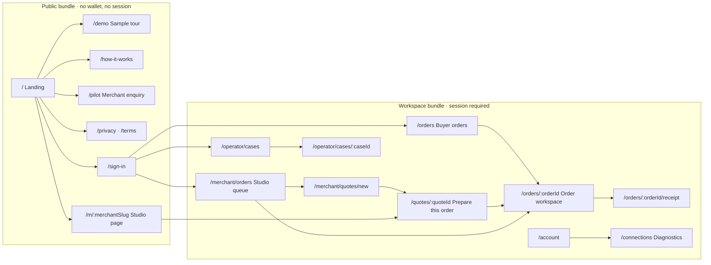
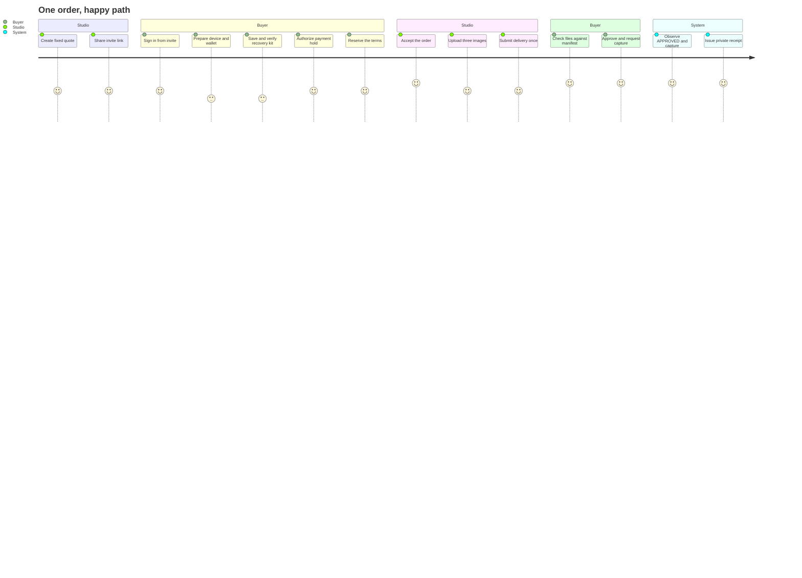
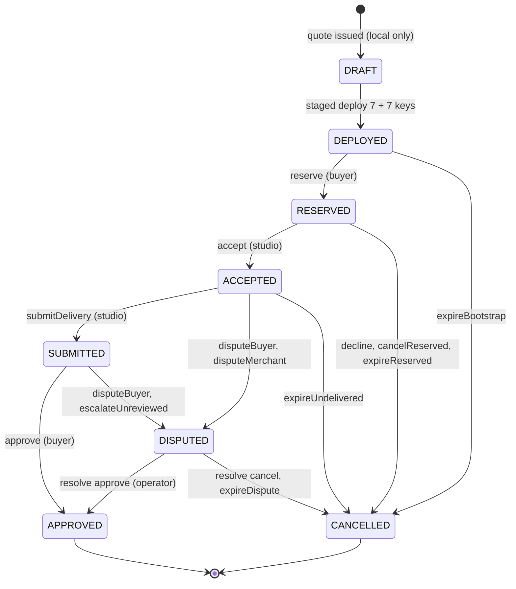
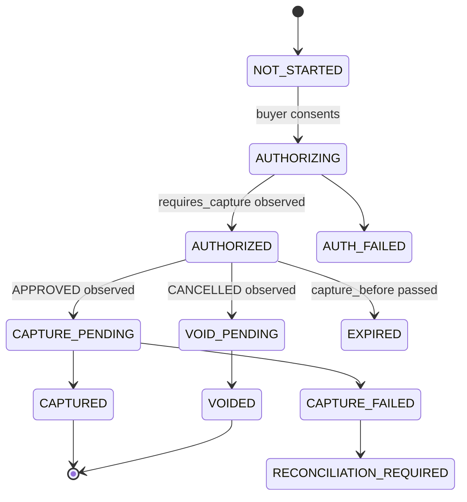
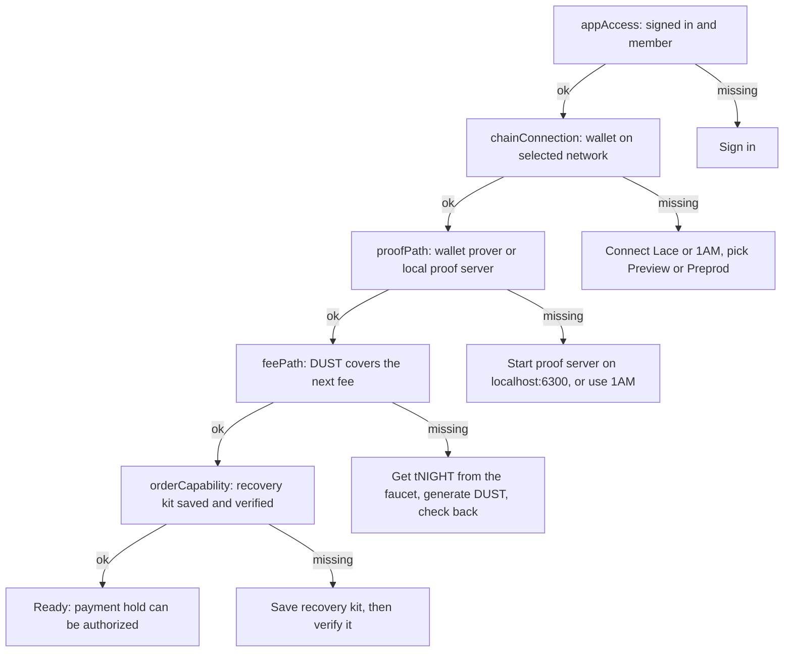
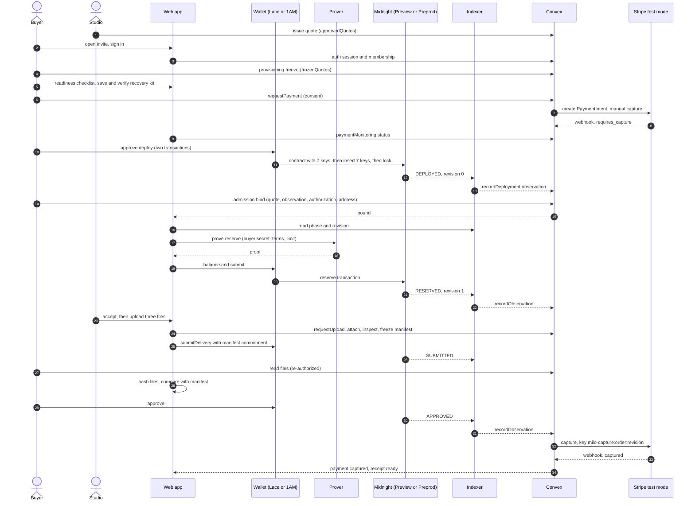
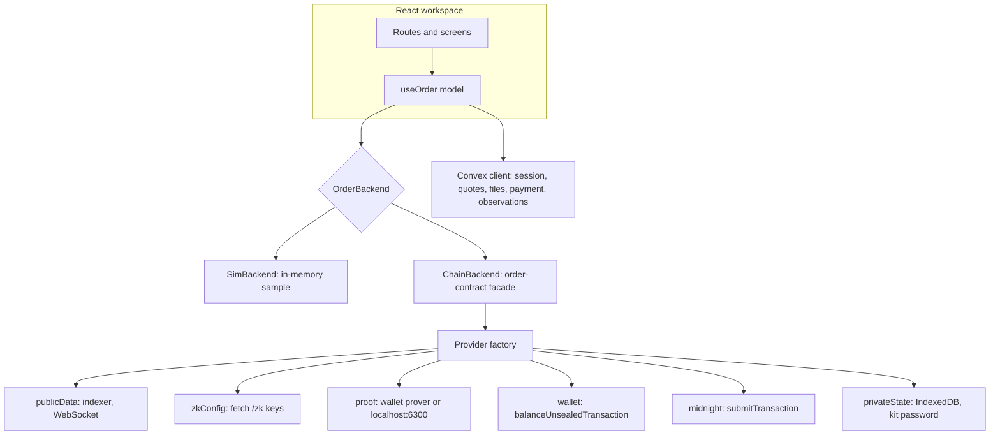

# 09 · Milo web app design

**Status:** design proposal, 2026-10-19. It builds on the canonical corpus in this folder and on
the code as it stands at `main` (`9a3bfdc`). Section references point at the source documents:
`01` blueprint, `02` roadmap, `04` UI design, `05` UX design, `06` backend design, `08` Midnight
core audit.

This document designs the whole product surface in one place: what each screen is for, how the
roles move through an order, the patterns every screen reuses, and how the browser, the wallet,
Midnight, Convex and Stripe fit together. Where the corpus and today's code disagree, section 1.2
records which one wins and why.

## 1. Foundations

### 1.1 Product in one paragraph

Milo is a private commissioning workspace for one bounded deal, profile `image-pack-v1`: one
buyer, one invited studio, one fixed price in USD, exactly three images (PNG, JPEG or WebP, at
most 5 MiB each), one immutable submission, and a full capture or a full cancel (`01` §1.1,
§4.1). Each order is its own Midnight contract. The ledger shows phase, revision, deadlines and
commitments. Price, scope, brief, files, the buyer's approval limit and every role secret stay
off chain (`01` §2.2). Stripe holds the money on a manual-capture authorization, and Milo
captures only after the chain shows `APPROVED` (`01` §5.1).

Allowed promise: "Commercial terms stay off the public ledger; Midnight verifies the order
rules." Never say "anonymous", "untraceable", "trustless escrow", "guaranteed quality" or
"Midnight settles your dollars" (`01` §2.2).

### 1.2 Decisions that override the corpus

| Topic | Corpus says | This design | Why |
| --- | --- | --- | --- |
| Identity | Privy email OTP (`01` header, `06` §4) | Better Auth inside Convex, email + password and guest | Privy was removed (`9afddc0`); the Convex component is installed and compatible |
| Fonts | System stacks only (`04` §2) | System stacks by default; Newsreader and Inter only once self-hosted with a checked license | Keeps `04` §2 intact while allowing the current look |
| Tokens | `#5434D7` violet, radii 8/16/24 (`04` §2.1) | Keep `tokens.css` (`#4A2FD0`, radii 4/8/12/20) | Already shipped and contrast-checked; one source of truth |
| Network | Preprod only | Preview by default, Preprod selectable, Mainnet blocked | Hosted Preprod endpoints were retired on 2026-10-09; Preview is keyless |
| Proving | Wallet-mediated or local proof server (`01` §3.7) | Same, stated up front: Lace forwards to `localhost:6300`; 1AM proves in the browser | Lace's `getProvingProvider` is an HTTP forwarder |
| `/connections` | Not specified | Kept as the diagnostics page, linked from Account | Judges and support need one honest status page |

### 1.3 Principles

1. **One account, one task.** Every page answers, in order: where am I, what is the state, who
   acts next, by when, and what happens if I act or do nothing (`04` §2.2).
2. **Consequences before consent.** An irreversible action names the merchant, amount, delivery
   version and consequence before the button, and the button states intent, not success
   (`05` §4.2).
3. **Visible truth, quiet machinery.** Pending proof, pending transaction, confirmed phase and
   captured payment are four different things on screen. Technical ids live in an expandable
   evidence panel (`01` §5.1, `04` §8.4).
4. **No phase without a record.** A phase label appears only when an observation backs it. A
   passed deadline reads "Deadline reached, awaiting the applicable action" and never flips the
   phase locally (`04` §7).
5. **Recovery is a first-class screen.** The recovery kit is saved and verified before any
   payment hold, and a lost capability has its own read-only route (`01` §5.5, §5.8).
6. **Simulation is labelled, always.** The sample workspace carries "Synthetic sample · no
   wallet, payment or transaction" on every screen. Chain-backed screens carry the network badge
   instead (`04` §4.4).

## 2. Information architecture

- **Two bundles.** The public bundle never loads auth, Convex, Stripe or Midnight code
  (`01` §2.4). The workspace bundle loads them, and the chain code is a separate lazy chunk that
  only order and quote routes import.
- **Panels, not routes.** Setup, the delivery viewer, the approval confirmation and the technical
  evidence are panels or dialogs inside the order (`04` §3).
- **Navigation.** One sidebar shows only the tasks the signed-in role may do. There is no
  "switch to merchant" control in the real workspace. The sample workspace keeps its role and
  scenario toolbar, labelled as a sample control (`04` §3, `05` anti-patterns).
- **Ids are not credentials.** A deep link resumes the named record after sign-in. No token,
  code, capability or password ever appears in a URL (`04` §3).
- **Not found and denied** share one screen that never reveals whether a private order exists.

## 3. Roles and journeys

| Role | Authority | Enters at | Typical tasks |
| --- | --- | --- | --- |
| Buyer | Buyer capability for one order | Invite link to `/quotes/:quoteId` | Prepare, reserve, cancel while reserved, review, approve or dispute |
| Studio (merchant) | Merchant capability | `/merchant/orders` | Quote, accept or decline, upload three files, submit, dispute while accepted |
| Dispute operator | Pre-committed operator capability | `/operator/cases` | Resolve a dispute to full approve or full cancel |
| Finance operator | Convex permission + Stripe | `/operator/cases` (finance tab) | Reconcile capture or void, handle incidents |
| Anyone with fees | None | Order page timeout banner | Fire an expiry circuit after a deadline |

Roles come from three independent checks: app sign-in (read access only), a chain connection
scoped to the action, and the per-order capability secret held in the recovery kit (`01` §3.4).
None of the three implies the others.

### 3.1 Happy path across roles

### 3.2 Branches every screen must handle

| Branch | Trigger | Result | What the user sees |
| --- | --- | --- | --- |
| Decline | Studio declines while `RESERVED` | `CANCELLED`, hold voided | "Studio declined. The hold is being released." |
| Buyer cancel | Buyer cancels while `RESERVED` | `CANCELLED` | Races accept; the stale attempt loses with a clear message |
| Dispute | Buyer in `ACCEPTED` or `SUBMITTED`, studio in `ACCEPTED` | `DISPUTED`, capture blocked | Case summary, evidence committed, operator deadline |
| Resolve | Operator | `APPROVED` (capture) or `CANCELLED` (void) | Full outcome only, no partial editor |
| Review window passes | Anyone calls `escalateUnreviewed` | `DISPUTED`, never auto-approve | "Review window ended. The order went to resolution." |
| Other deadlines pass | Anyone calls the matching expiry | `CANCELLED` | Timeout banner offers the call if the visitor has a funded wallet |
| Hold expires | Stripe `capture_before` passes | Payment `EXPIRED`, phase unchanged | Warning tone, "Payment hold expired, payment unresolved" |
| Capability lost | Recovery kit missing or wrong password | Read-only order | Phase-dependent route: studio, operator or public timeout |

## 4. State model

### 4.1 Order phase (on chain)

Every circuit checks the sealed configuration, the phase and `expectedRevision`, then increments
the revision (`order.compact:80`). The UI always reads the current revision from the indexer
before it builds a call, never from a cached value.

### 4.2 Payment (off chain, Stripe test mode)

### 4.3 How the two combine on screen

| Phase | Payment | Header status | Payment panel | Tone |
| --- | --- | --- | --- | --- |
| `RESERVED` | `AUTHORIZED` | Reserved, waiting for the studio | Hold authorized, not captured, expires {time} | Neutral |
| `SUBMITTED` | `AUTHORIZED` | Delivery ready for review | Hold authorized, not captured | Accent |
| `SUBMITTED` | `EXPIRED` | Delivery ready for review | Hold expired, payment unresolved | Warning |
| `APPROVED` | `CAPTURE_PENDING` | Approved | Approval confirmed, payment processing | Neutral |
| `APPROVED` | `CAPTURED` | Approved | Captured {amount} on {date} | Success |
| `APPROVED` | `CAPTURE_FAILED` | Approved | Capture failed, finance is reconciling | Danger |
| `CANCELLED` | `VOID_PENDING` | Cancelled | Hold being released | Neutral |
| `DISPUTED` | `AUTHORIZED` | In resolution | Capture blocked until resolution | Warning |

The two panels never merge into one green "Success" (`04` §11). An expired hold does not reopen
or change the order (`05` §7).

## 5. Screens

Each entry lists purpose, primary action, content in order, and the states it must render. Every
workspace screen also renders loading (stable heading and skeleton), denied, stale (observation
older than five minutes) and interrupted return (`05` §7).

### 5.1 Public

**`/` Landing** (`04` §4.1). Primary: "Explore a sample order". Secondary: "Discuss a merchant
pilot". Blocks: header; hero "Private agreements. Clear approvals." with a sealed sample card
labelled "Sample order"; the three-image pack with its scope; three steps (agree, review,
approve); the privacy split (public ledger beside private details); walkthrough mockup; studio
value; FAQ; closing CTA. Motion: one signature effect, the sealed card dealing in and stamping at
"Approved"; static under reduced motion or when scripts fail.

**`/demo` Sample tour** (`04` §4.4). Primary: step forward. A native "Sample context" select
(SC-01 to SC-07, unknown ids fall back to SC-01) and four steps: understand, inspect, understand
approval, inspect outcome. Approval and payment are shown as separate panels with an optional
"Payment pending example". Evidence panels read "Illustrated check, not executed". No pay
button, no transaction id, no network calls.

**`/how-it-works`** turns the steps into a vertical timeline with the phase stepper running down
the side. Each step pairs a public ledger tick with a private sealed-envelope glyph.

**`/pilot`** is a short merchant page: what the pilot includes, what it does not, and one honest
contact link.

**`/privacy`, `/terms`** use a sticky table of contents and a "Public / Private" key in the
margin. No motion beyond link underlines.

**`/m/:merchantSlug` Studio page** shows the studio name, a verified-invite badge, a portfolio
of sample work and "Request a quote". It never lists live orders.

**`/sign-in`** (`05` §5.1). Primary: "Continue to your order". Email and password, plus "Try as
guest" for judges. After sign-in, wait for the Convex membership check before any private content
renders. An uninvited account sees an access explanation with no content flash. The validated
return route resumes the invite.

### 5.2 Buyer

**`/quotes/:quoteId` Prepare this order** (`04` §6). Desktop is two columns: the agreement on the
left (studio, context, fixed scope, three outputs, rights, total, deadlines with time zone,
resolution policy, who receives what) and the readiness checklist on the right. Mobile shows the
agreement summary above the one active step.

The readiness checklist (pattern 6.1) has three steps and expands only the current blocker:

1. Prepare this device: network, wallet, proof path, DUST.
2. Save and verify the recovery kit.
3. Authorize the payment hold. Locked until 1 and 2 pass.

Copy under the list: "No hold has been placed. Save and leave at any time, nothing is charged
automatically." After the Stripe return the page reconciles the PaymentIntent itself; a success
URL is not success. Then "Reserve the terms" opens the transaction dialog (pattern 6.3).

**`/orders` Buyer orders.** Cards with the studio, the three thumbnails, a mini phase stepper,
the next actor and the deadline. Empty state explains that orders arrive by invite. No sample
rows that look live.

**`/orders/:orderId` Order workspace** (`04` §7). The most important screen.

- Header: title, phase badge, network badge, the next actor and the absolute deadline.
- Left column: delivery (three file cards with check status), agreed scope, rights.
- Right column: "Your next step" with the one primary action, then the payment panel.
- Below: the order timeline (pattern 6.6) and the technical evidence panel (pattern 6.7).
- Mobile order: header, task and deadline, work, summary, timeline. The sticky action bar never
  covers focus, dialogs or the keyboard.

Review state: each file shows "Checking file", "Matches submitted manifest", "Cannot verify" or
"File unavailable". A mismatch blocks approval. "Approve delivery" opens the confirmation
(pattern 6.4) whose final button reads "Approve delivery and request payment capture". The
dispute link stays visible next to it.

**`/orders/:orderId/receipt`** (`04` §8.3). Three sections: order approval, delivery identity,
payment. "Download my private receipt" is separate from any public bundle. "What was verified?"
sits next to "Who can see this?". Network, contract address, transaction ids and the delivery
fingerprint are in an expandable block. The sample receipt carries "Sample receipt, not a proof".

### 5.3 Studio

**`/merchant/orders` Studio queue** (`04` §9.1). Three groups: "Needs your action", "Waiting for
buyer", "Exceptions". Rows show service, counterpart (if authorized), next actor, deadline and
hold state. Rows slide in with a short stagger.

**`/merchant/quotes/new`** (`05` §5.1). The fixed service form on the left, a live agreement
preview on the right that updates as the studio types. Review scope, rights, deadlines and
parties before "Issue quote". Issuing places no hold.

**Accept and deliver** happen inside the order workspace. Accept is enabled only when the hold is
observed usable. Upload has three explicit slots with format and size rules, per-file progress
and per-file retry. The manifest preview states that v1 cannot replace a submitted delivery.
"Submit delivery" opens the transaction dialog.

### 5.4 Operator

**`/operator/cases`** lists cases with state, deadline, observation freshness and owner, split
into "Disputes" and "Finance".

**`/operator/cases/:caseId` Resolution desk** (`04` §9.2). Policy, the agreed scope beside the
delivered files, committed evidence, the timeline and the payment condition. Two outcomes only:
"Approve in full" and "Cancel in full", each through the confirmation pattern. "Reconcile
external status" is a separate finance action. No partial refund editor, no impersonation, no
force-approve.

### 5.5 Account and diagnostics

**`/account`** (`04` §9.3). Identity, my orders, local wallet connection, recovery kits per
order, support and sign out. Recovery copy explains the three parts: the wallet, the order
capability and the Convex record, and that none restores the others. It never asks for a seed
phrase. The support form shows exactly which diagnostic fields will be shared.

**`/connections` Diagnostics.** Three status cards: identity (session and membership), wallet
(Lace or 1AM, network, proof path, DUST) and records (Convex order record, payment monitor). Each
card states OK, needs attention or off in words, never by color alone.

## 6. Patterns

### 6.1 Readiness checklist

One component used on the quote page and in `/connections`. It tracks the five coordinator
states from `01` §3.4.2: `appAccess`, `chainConnection`, `orderCapability`, `proofPath` and
`feePath`. Only the first unmet item is expanded. Each item says what it checks, why, and the
one action that fixes it. Completed items stay revisitable.

### 6.2 Network switcher

A compact select in the workspace header: Preview (default) or Preprod. The choice is stored
locally and the page reloads on change, because the Midnight SDK holds one network per page. The
wallet must report the same network after connect, or the page shows "Your wallet is on
{network}. Switch it in the wallet, then reconnect." Mainnet is refused in words.

### 6.3 Transaction dialog

Used for deploy, reserve, accept, submit, approve, dispute, resolve and expiry calls. It shows
only real stages, each with its own copy, and never a fake percentage:

1. Checking the current revision.
2. Preparing the proof (the prover receives your private inputs).
3. Waiting for your wallet (only if a prompt actually appears).
4. Submitted, waiting for the network.
5. Confirmed in block {n}, phase {phase}.

If the outcome is unknown, the dialog shows "Outcome being checked", keeps the operation id and
disables a second send (`04` §7). Deploy shows its three steps (contract with 7 keys, insert 7
keys, lock maintenance) as one progress list.

### 6.4 Consent and confirmation

The confirmation for an irreversible action lists merchant, amount, delivery version and
consequence, then two buttons: a quiet "Back to review" and the intent button. No preselected
checkbox and no countdown. Consent is invalidated if the quote, revision, network or wallet
changes while the dialog is open (`05` §4.2).

### 6.5 Dual-ledger panel

The signature pattern. Two columns: "Public on Midnight" (phase, revision, deadlines,
commitments, read from the indexer) and "Private to this order" (price, scope, files, approval
limit, shown only to members). A thin seal sits between them. On the sample workspace the public
column carries "Synthetic values".

### 6.6 Order timeline

Every event in order with its source: "Chain", "Stripe", "Milo" or "You". Chain events link to
the evidence panel. Pending events are drawn hollow and never ticked.

### 6.7 Technical evidence

Collapsed by default. Network, contract address, current revision, transaction ids, delivery
fingerprint, observation time and freshness. A copy button for each id. Stale data shows its age
in words.

### 6.8 Deadlines

Absolute time with time zone first, remaining time second. Always name the next actor and the
consequence: "Studio delivers by 21 Oct 14:00 UTC. If not, anyone may cancel the order and the
hold is released."

### 6.9 Errors and notices

Every error states what happened, what did not happen, whether a hold or submission may exist,
what was kept, and the next permitted action (`04` §10). Financial and privacy problems are
persistent inline notices, never only a toast. "Try again" reconciles first.

### 6.10 Simulation and chain badges

Sample screens: "Synthetic sample · no wallet, payment or transaction". Chain screens: the network
badge plus "Live on {network}". Both never appear together.

### 6.11 Motion

Product screens follow `04` §12.1: opacity and transform only, 120 to 220 ms,
`cubic-bezier(0.2, 0.7, 0.2, 1)`. Moments: panel reveal, route change, validation failure,
observed confirmation (seal stamp), pending proof (a slow pulse tied to the real stage). The
landing may use the bolder showreel moves. Reduced motion shows the same content at once.

## 7. Integration flow

### 7.1 Order lifecycle across systems

The admission check needs the deployment observation before binding, so deploy comes before
bind (`convex/admission.ts`, `canonicalAdmission.ts:21`).

### 7.2 Browser architecture

- **One model, two backends.** `useOrder` exposes the same state and actions for the sample and
  the chain. The screen never branches on which backend is active, only the badge does.
- **Chain state from the indexer.** The chain backend reads phase and revision directly from the
  indexer. Convex keeps the durable record and drives settlement; it is evidence, not authority
  (`06` §2.1).
- **Secrets stay in the browser.** Role secrets, the terms opening, the approval limit and the
  maintenance key live in the recovery kit and IndexedDB, never in Convex (`06` §2.2).
- **Lazy chain chunk.** The 10 MB ledger WebAssembly and the prover keys load only on quote and
  order routes.

### 7.3 Who calls what

| Step | Caller | Function or circuit | Sync | Idempotency |
| --- | --- | --- | --- | --- |
| Freeze quote | Buyer | `provisioning:freeze` | Mutation | Re-freeze only if identical |
| Hold | Buyer then Convex | `provisioning:requestPayment` then `stripeProvisioning:run` | Async action | `milo-test-intent:{jobId}` |
| Deploy | Buyer wallet | Constructor, key insert, lock | 3 transactions | Never auto-retry an unknown submit |
| Observe deploy | Observer | `observationIngest:recordDeployment` | Mutation | recorded, replay, stale, contradictory |
| Bind | Buyer | `admission:bind` | Mutation (OCC) | bound or already-bound |
| Circuits | Role wallet | `reserve` ... `resolve`, expiries | Transaction | `expectedRevision` |
| Observe phase | Observer | `orders:recordObservation` | Mutation | bind, stale, contradictory, address-claimed |
| Files | Studio, buyer | `files:requestUpload`, `freeze`, `serveFile` | Mutation, action | One manifest per order |
| Settle | Convex | `settlement:request`, `stripeSettlement:run`, `sweep` | Async | `milo-{action}:{orderId}:{revision}` |
| Webhook | Stripe | `POST /webhooks/stripe` | HTTP | Inbox keyed by event id |

## 8. Design system

- **Tokens.** `apps/web/src/tokens.css` is the single source: paper, surface, ink, one indigo
  accent, success, warning, danger, privacy slate; radii 4, 8, 12, 20; type scale from `04` §2.2.
  Add a named spacing scale (4 to 96 px) and merge the duplicated rule blocks in `workspace.css`.
- **Components** (`04` §11), with their homes:

| Component | Purpose | Home |
| --- | --- | --- |
| `AppShell`, `PageHeader` | Sidebar, header, network badge, skip link | `shells/` |
| `OrderSummary`, `DualLedger` | Agreement and public/private split | `components/order.tsx` |
| `ReadinessChecklist` | Pattern 6.1 | new `components/readiness.tsx` |
| `TxDialog` | Pattern 6.3 | new `components/tx-dialog.tsx` |
| `ActionConfirmation` | Pattern 6.4 | `components/OrderDialog.tsx` |
| `PaymentStatus` | Payment panel and tones | `components/order.tsx` |
| `DeliveryViewer`, `DeliveryUpload` | Three files, checks, upload slots | new `components/delivery.tsx` |
| `OrderTimeline`, `EvidenceDetails` | Patterns 6.6, 6.7 | `components/order.tsx` |
| `StatusNotice`, `Badge` | Icon plus text, persistent notices | `components/ui.tsx` |
| `NetworkSwitcher` | Pattern 6.2 | new `components/network.tsx` |

- **Accessibility.** WCAG 2.2 AA, 44 by 44 px primary targets, visible focus distinct from hover,
  200 percent zoom, 320 px reflow, keyboard paths through the viewer and every dialog, live
  regions that do not steal focus (`01` §7.4).

## 9. Gaps between this design and the code

| Area | Today | Needed | Phase |
| --- | --- | --- | --- |
| Sign-in | No Better Auth server, `/sign-in` is an info page | `convex/convex.config.ts`, `convex/auth.ts`, routes, form, guest | 3 |
| Membership | Only trusted provisioning | Seed or guest self-provision as buyer | 3 |
| Network | `preprod` literal in about 80 places | Preview and Preprod union, switcher, tests | 2 |
| Wallet | Status only, submit path `UNKNOWN` | Lace and 1AM adapters, `balanceUnsealedTransaction`, `submitTransaction` | 2 |
| Contract | Reserve and accept descriptors only | `order-contract.ts` facade for all 14 circuits and staged deploy | 2 |
| Build | Bun cannot load the ledger WebAssembly | Bun plugin, runtime dedupe, lazy chain chunk, `/zk` assets | 2 |
| Workspace | Simulator only | `OrderBackend` with sim and chain implementations | 2 |
| Files | `serveFile` internal, no HTTP route | Authenticated download route, browser hash check | 3 |
| Settlement | No caller, no cron | `crons.ts`, trigger on observed phase, fresh Stripe read before capture | 3 |
| Webhook | `reconcile` call omits `provider` | Fix the call, move idempotency key to the header | 3 |
| Order tables | `chainOrders` and `orders` never created or linked | Create on bind, one projection | 3 |
| Screens | Operator detail reuses order view; upload, receipt, account are thin | Resolution desk, three-slot upload, full receipt, recovery center | 1 then 2 |
| Hosting | `public-config` served as octet-stream, 46 MB keys | JSON content type, immutable cache for `/zk`, upload budget | 3 |

## 10. Open decisions

1. Judge access: guest sign-in, pre-seeded accounts, or both.
2. Second wallet: support 1AM so judges can prove in the browser without Docker.
3. Preprod key: a dedicated low-quota Blockfrost key in the browser, or a server proxy.
4. Fonts: keep system stacks per `04` §2, or self-host Newsreader and Inter.
5. A pre-deployed fallback contract per network for judges without DUST.

<!-- markdownlint-configure-file {
  "MD013": { "line_length": 100, "tables": false, "code_blocks": false }
} -->
